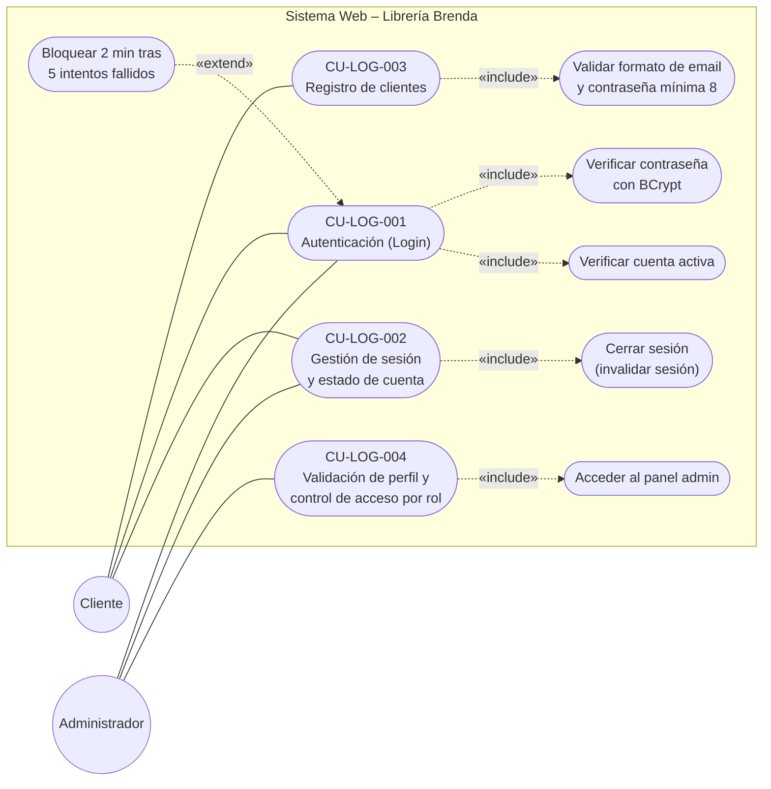
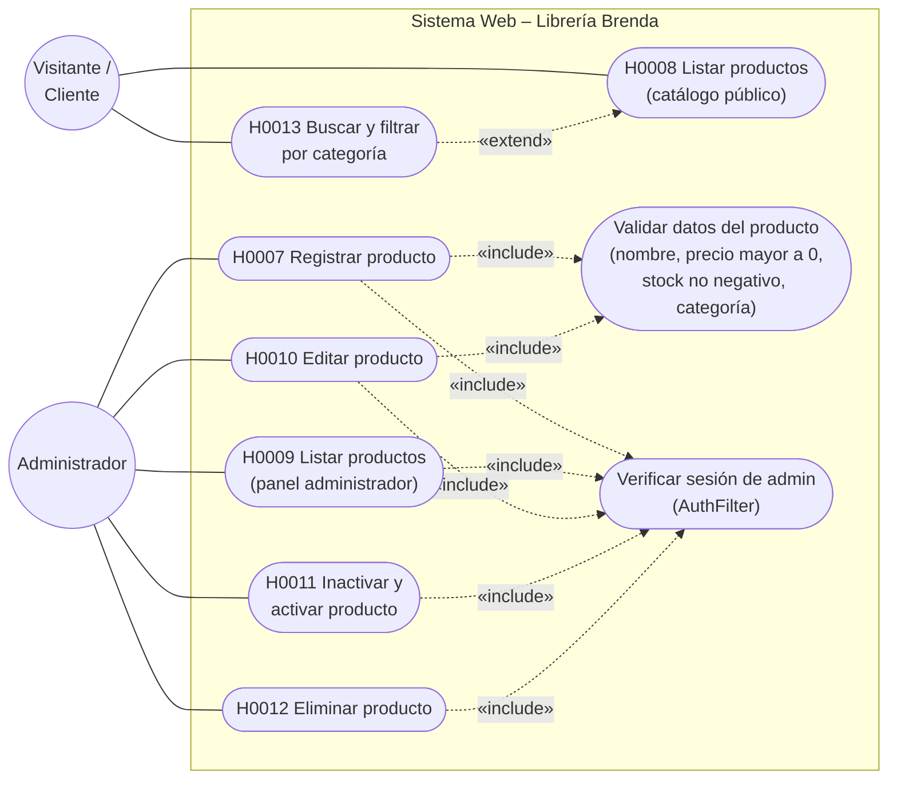

# Diagramas de casos de uso – Librería Brenda (Sprint 1 y Sprint 2)

> Mermaid no tiene un tipo "use case" nativo, así que se dibuja con `flowchart`:
> actores = círculos, casos de uso = óvalos, frontera del sistema = recuadro.
> En VS Code: instala la extensión **Markdown Preview Mermaid Support** (o "Mermaid Chart"),
> abre este archivo y presiona `Ctrl+Shift+V`. Para exportar a imagen: https://mermaid.live
> (pegas el bloque de código) → Actions → PNG/SVG.

## 1. Sprint 1 – Login y seguridad (CU-LOG-001 a CU-LOG-004)

## 2. Sprint 2 – Catálogo de Productos (H0007 a H0013)

## Notas para verificar antes de entregar

- CU-LOG-001 a 004 y H0007 a H0013 salen de tu bitácora y del Informe del Sprint 2.
- Las relaciones «include» y «extend» son una interpretación del diseño (por ejemplo, el bloqueo tras 5 intentos como extensión del login). Ajusta si en su análisis lo modelaron distinto.
- El panel de administrador también tiene buscador y filtros (dentro de H0009), por eso no hay una historia aparte para el admin.
